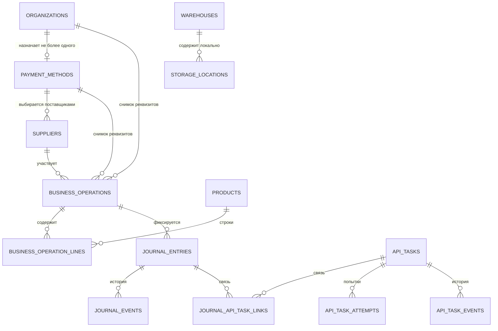

# Модель данных Lerua Zakup — ER и ограничения

**Статус:** проект для согласования вместе с технической спецификацией.  
**База:** одна SQLite; все локальные ID — внутренние стабильные ключи. Внешние ID МойСклад хранятся отдельно и уникальны в пределах соответствующего типа сущности.

## 1. Связи сущностей

Пояснение к связи способов оплаты: у организации максимум один способ оплаты; каждый способ оплаты назначается максимум одной организации. Один способ оплаты может быть выбран несколькими поставщиками. В карточке поставщика хранится ссылка на выбранный способ оплаты; организация определяется через него. В предложенной первой версии у поставщика одно текущее назначение способа оплаты. Если пользователь захочет несколько вариантов для одного поставщика, потребуется отдельная таблица-связка и выбор варианта в бизнес-операции.

## 2. Основные таблицы и ограничения

### `organizations`

| Поле | Назначение |
|---|---|
| `id` | локальный PK |
| `moysklad_id` | внешний ID, UNIQUE, NOT NULL |
| `name` | синхронизируемое название |
| `is_archived` | архивность во внешней системе |
| `is_present` | присутствие в последней полной синхронизации |
| `updated_at` | время последнего обновления |

### `payment_methods`

| Поле | Назначение |
|---|---|
| `id` | локальный PK |
| `name` | локальное название |
| `organization_id` | nullable FK → organizations.id, UNIQUE |
| `created_at`, `updated_at` | локальные даты |

Ограничение UNIQUE на `organization_id` гарантирует, что одна организация не получит два способа оплаты. Само поле UNIQUE гарантирует, что один способ оплаты не будет назначен двум организациям. SQLite допускает несколько NULL, поэтому свободные способы оплаты остаются возможными.

### `suppliers`

| Поле | Назначение |
|---|---|
| `id` | локальный PK |
| `moysklad_id` | внешний ID, UNIQUE, NOT NULL |
| `name` | синхронизируемое название |
| `phone` | синхронизируемый телефон |
| `relevance_status` | локально: актуальный / прочие |
| `payment_method_id` | nullable FK → payment_methods.id |
| `last_synced_at` | дата обновления внешних полей |

Локальное поле `payment_method_id` не отправляется в МойСклад. Обновление поставщика из API не должно менять локальный статус или выбранный способ оплаты.

### `warehouses`

| Поле | Назначение |
|---|---|
| `id` | локальный PK |
| `moysklad_id` | внешний ID, UNIQUE, NOT NULL |
| `name` | синхронизируемое название |
| `is_archived`, `is_present` | внешнее состояние |
| `last_synced_at` | дата обновления |

### `storage_locations`

| Поле | Назначение |
|---|---|
| `id` | локальный PK |
| `warehouse_id` | NOT NULL FK → warehouses.id |
| `name` | локальное название |
| `sort_order` | локальный порядок |
| `is_active` | локальное состояние |
| `created_at`, `updated_at` | локальные даты |

Рекомендуемое ограничение: UNIQUE(`warehouse_id`, `name`) — если пользователь не должен создавать в одном складе два места с одинаковым названием. Это ограничение является предложением и требует подтверждения. Ни одно действие с `storage_locations` не создаёт запись в `api_tasks`.

### `products`

| Поле | Назначение |
|---|---|
| `id` | локальный PK |
| `moysklad_id` | внешний ID, UNIQUE, NOT NULL |
| `name` | синхронизируемое название |
| `kind` | товар / услуга |
| `stock` | общий физический остаток |
| `uom_name` | единица измерения или «Не указано» |
| `relevance_status` | локально: не распределён / актуален / не актуален |
| `is_archived`, `is_present` | состояние внешнего каталога |
| `last_synced_at` | дата обновления |

### `business_operations`

Минимальные поля общего механизма (конкретный тип документа ещё не выбран):

- локальный `id` и отдельный `operation_uid` для защиты от повторного локального создания;
- `operation_type`, `business_status`, `created_at`, `updated_at`;
- `supplier_id` (nullable FK);
- `organization_moysklad_id_snapshot` — обязательный для операции, которой нужна организация;
- `organization_name_snapshot` — предлагаемое дополнительное отображаемое значение;
- `payment_method_id_snapshot` и `payment_method_name_snapshot`;
- `payload_json` — версионируемое содержимое специфичных для типа операции полей.

ID организации и способа оплаты обязательны в историческом снимке согласно решению пользователя. Названия — дополнительное предложение для читаемости истории, не замена ID.

### `business_operation_lines`

- локальный ID;
- FK на операцию;
- FK на локальный товар;
- снимок внешнего ID товара и ключевых полей строки на момент добавления;
- количество, единица измерения и прочие поля, определяемые конкретным видом операции;
- одинаковый товар может присутствовать несколькими отдельными строками.

### Журнал и API-задачи

**`journal_entries`** — запись Журнала: ID, тип события/бизнес-объекта, ссылка на локальную операцию при наличии, снимок ключевых полей, текущее агрегированное состояние, даты.

**`journal_events`** — append-only история: journal_entry_id, event_type, from_state, to_state, timestamp, безопасные детали.

**`api_tasks`** — ID, task_type, logical_queue, status, FIFO sequence/created_at, payload, attempts_count, next_attempt_at, started_at, finished_at, idempotency/reference metadata.

**`api_task_attempts`** — номер попытки, времена, HTTP status, классификация результата, очищенный фрагмент ответа/ошибки.

**`api_task_events`** — история переходов задачи.

**`journal_api_task_links`** — таблица связей с FK на обе стороны; UNIQUE по паре ID. Она допускает одну запись Журнала с несколькими задачами и несколько записей Журнала, связанных с одной задачей.

## 3. Транзакционные правила

1. Создание подтверждённой бизнес-операции, строк и первичной записи Журнала — одна SQLite-транзакция.
2. Добавление API-задач и ссылок на Журнал выполняется в транзакции, чтобы не оставлять запись операции без задачи или задачу без связи.
3. Результат HTTP-запроса, попытка и переход статуса фиксируются локально до запуска следующей задачи.
4. Полная синхронизация справочника: данные загружаются во временный набор/таблицы staging; после проверки полноты выполняется атомарное обновление рабочей таблицы.
5. Локальные поля (статусы актуальности, выбранный способ оплаты, места хранения) не изменяются внешней синхронизацией.
6. Снимки реквизитов операции не обновляются вслед за изменениями справочников.

## 4. Индексы

Минимально предусмотреть:
- UNIQUE индексы на внешние `moysklad_id` для товаров, складов, организаций, поставщиков;
- индекс `products(relevance_status, name)`;
- индекс `suppliers(name)` для локального списка сохранённых поставщиков;
- индекс `api_tasks(status, created_at)` для диспетчера;
- индекс `journal_entries(created_at)`;
- индекс `journal_events(journal_entry_id, created_at)`;
- индекс `storage_locations(warehouse_id, sort_order)`.

Поисковые индексы должны учитывать SQLite LIKE/коллацию и фактическое поведение поиска по части названия; при необходимости отдельно проверить FTS, не вводя его без измеримой пользы.

## 5. Открытые решения модели

- Подтвердить, что в карточке поставщика одновременно выбирается только один текущий способ оплаты. Это естественно следует из формулировки «выбрать способ оплаты», но отдельная кардинальность для поставщика прямо не задавалась.
- Подтвердить, нужно ли запрещать одинаковые названия мест хранения внутри одного склада.
- Определить политику при архивировании/исчезновении склада, если у него уже есть локальные места хранения: не удалять дочерние места автоматически; предложить архивировать склад и сохранить локальную структуру до отдельного решения.
- Уточнить окончательный состав снимка реквизитов и строк операции после выбора первой бизнес-операции.
